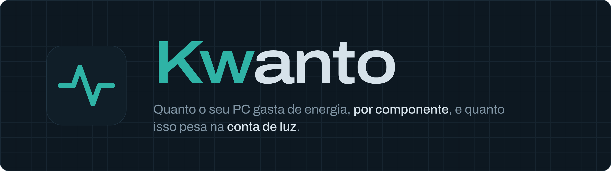
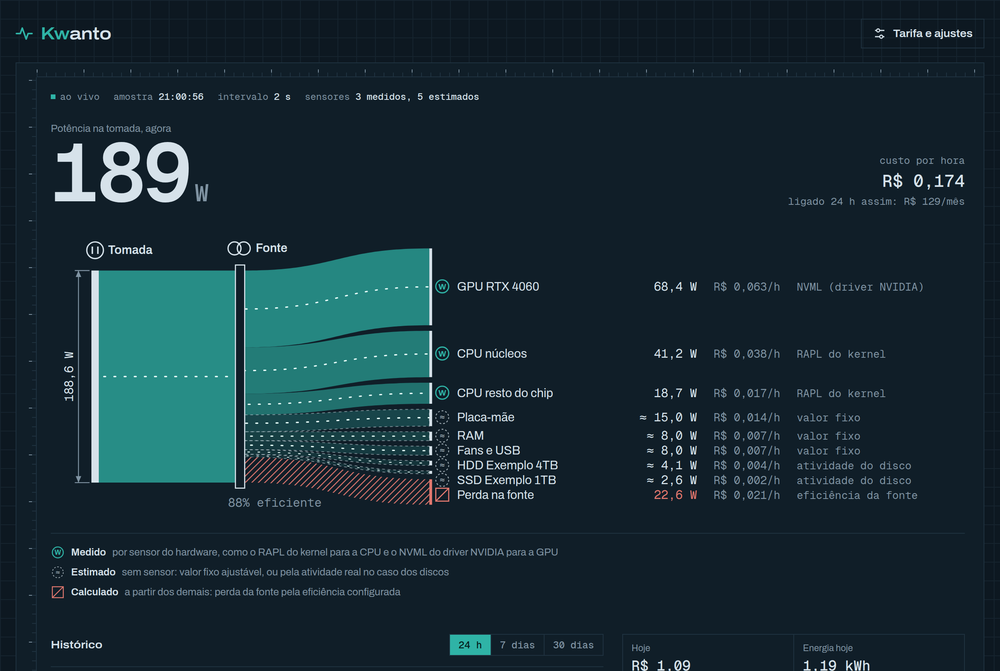

  

# Kwanto

O Kwanto mostra, ao vivo, quantos watts o seu PC puxa da tomada e de onde eles vêm: placa de vídeo,
processador, discos e o resto. Com a sua tarifa, ele calcula quanto cada parte custa por hora, quanto
você já gastou no ciclo da conta de luz e quanto deve pagar até o fim dele.

- **Ao lado do relógio:** o consumo aparece na bandeja do sistema; um clique abre o resumo.
- **Medido quando dá, estimado quando não:** cada número diz de onde veio.
- **Seus dados ficam no seu PC:** sem conta, sem nuvem, sem telemetria.

  

## Instalar

Baixe o pacote do seu sistema na [página de versões](https://github.com/gabrielpcruz/kwanto/releases/latest)
e abra-o com a central de programas, ou instale pelo terminal:

    sudo apt install ./kwanto_*_amd64.deb      # Ubuntu 22.04 ou mais novo, Debian 12, Linux Mint
    sudo dnf install ./kwanto-*.x86_64.rpm     # Fedora

Funciona em PCs x86_64 com Linux e systemd. No Arch, o `PKGBUILD` em
[packaging/aur](packaging/aur) compila o Kwanto do código-fonte.

O pacote já liga o serviço que mede o consumo. A bandeja abre sozinha a partir do próximo login, ou
agora mesmo pelo menu de aplicativos, em "Kwanto".

Para o ícone aparecer, o ambiente gráfico precisa ter área de notificação. No GNOME, isso vem da
extensão "AppIndicator and KStatusNotifierItem Support", que o Ubuntu já traz ativa; KDE Plasma,
Cinnamon, XFCE e MATE já têm. No GNOME com Wayland, o resumo pode abrir no meio da tela, porque lá
quem decide a posição das janelas é o próprio GNOME.

## Primeiro passo: a sua tarifa

Os valores em reais só ficam certos com a tarifa da sua conta. Abra o painel (botão **Abrir
dashboard** no resumo da bandeja, ou http://127.0.0.1:8787 no navegador) e clique em **Tarifa e
ajustes**:

- **Tarifa:** o valor do kWh com impostos, que aparece na conta de luz.
- **Adicional da bandeira:** o acréscimo da bandeira tarifária do mês (zero na verde).
- **Dia de início do ciclo:** o dia em que a sua distribuidora faz a leitura do medidor.

## O que é medido e o que é estimado

| Parte | Como o Kwanto sabe | No painel |
|---|---|---|
| Processador (Intel e AMD) | contador de energia do próprio processador (RAPL), pelo kernel | medido |
| Placa de vídeo NVIDIA | driver da NVIDIA (NVML) | medido |
| Placa de vídeo dedicada AMD ou Intel | sensor da placa, pelo kernel | medido |
| SSDs e HDDs | quanto tempo cada disco passou trabalhando, e se o HDD está parado | estimado |
| Placa-mãe, memória, ventoinhas, USB | valores fixos que você pode ajustar | estimado |
| Perda na fonte | calculada pela eficiência da fonte | calculado |

Num PC sem o contador do processador (algumas máquinas virtuais e processadores antigos), o
processador também é estimado, pelo quanto está sendo usado. Para acertar as estimativas, compare o
total do Kwanto com um medidor de tomada e ajuste os valores em **Tarifa e ajustes**.

## Atualizações

Uma vez por dia, a bandeja confere se saiu uma versão nova e, se saiu, pergunta numa notificação:

- **Atualizar:** baixa o pacote e o sistema pede a senha de administrador para instalar.
- **Agora não:** não pergunta mais sobre essa versão; avisa de novo quando sair a seguinte.
- **Não perguntar mais:** desliga a verificação.

Só são instaladas versões assinadas pelo projeto e mais novas que a sua. No Arch e em instalações
compiladas, a bandeja só avisa que saiu versão nova.

## Privacidade

O que sai do seu PC: só a conferência de versão nova, uma vez por dia, que lê dois arquivos públicos
no GitHub, e o download do pacote quando você escolhe atualizar. O Kwanto não envia o seu consumo, a sua configuração nem dados da máquina para lugar
nenhum. Para desligar essa conferência, escolha **Não perguntar mais** na notificação, ou deixe o
arquivo `~/.config/kwanto/atualizacao.json` assim:

    {"verificar": false, "pular": null}

Dentro do PC, o painel e os dados só respondem ao usuário que está usando a máquina: outra conta no
mesmo computador, inclusive por acesso remoto, não vê o seu histórico. Os detalhes estão em
[docs/seguranca.md](docs/seguranca.md).

## Desinstalar

    sudo apt remove kwanto    # mantém o histórico de consumo
    sudo apt purge kwanto     # apaga também o histórico
    sudo dnf remove kwanto    # Fedora; o histórico fica em /var/lib/kwanto

## Dúvidas

**Ele precisa de root?** Não. O serviço roda com um usuário próprio, sem privilégios; só a instalação
pede a senha de administrador.

**E o horário de verão?** O Kwanto usa o fuso do sistema. Se o horário de verão voltar, a atualização
normal da distribuição traz as regras novas e as contas continuam certas.

**Encontrei um problema de segurança.** Veja [SECURITY.md](SECURITY.md); não abra uma issue pública.

**Quero contribuir.** Veja [CONTRIBUTING.md](CONTRIBUTING.md).

## Licença

Apache-2.0.
